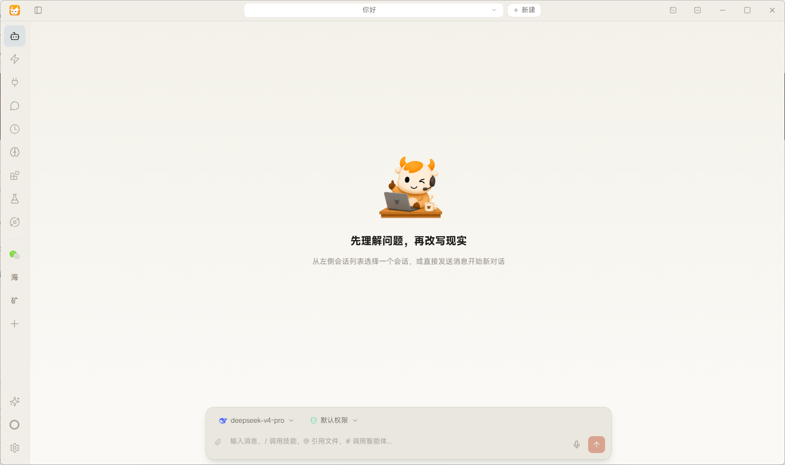

# Tokeny

## English

**Tokeny** is a desktop AI agent for Windows x64, macOS (Apple Silicon / Intel) and Linux x64. It is free to download and closed source, operated by Beijing Xinghe Qianfan Technology Co., Ltd.

Tokeny does not ship with a general model quota: you bring your own API key. DeepSeek is one of the built-in model channels — paste a key from the [DeepSeek Open Platform](https://platform.deepseek.com/), enable the models you want, run the connection test, then pick a DeepSeek model in the chat input. Calls made with your key are billed by DeepSeek.

**What it does with DeepSeek:**
- **Works on local files**: each conversation belongs to a workspace folder; the agent can read, create and edit files there within permission rules, and risky operations can pause for your approval.
- **Skills**: built-in skills for PPT (`.pptx`), Word (`.docx`), data analysis, deep research reports and web research; more can be installed.
- **MCP tools**: connect external MCP servers; the agent discovers their tools on demand.
- **Scheduled tasks**: cron-based tasks such as a daily report.
- **Multi-model**: multiple keys per channel with automatic failover, other built-in providers and custom OpenAI / Anthropic-compatible endpoints, and MoA (one aggregator plus up to four advisor models).

## 简体中文

**Tokeny** 是一款桌面 AI Agent，支持 Windows x64、macOS（Apple 芯片 / Intel）和 Linux x64。软件免费下载，闭源，由北京星河千帆科技有限公司运营。

Tokeny 不自带通用模型额度，需要使用你自己的 API Key。DeepSeek 是内置模型渠道之一：在 [DeepSeek 开放平台](https://platform.deepseek.com/) 获取 Key，粘贴到「AI 模型」中的 DeepSeek 渠道，启用模型并测试连接后，在输入框选择 DeepSeek 模型即可。使用自己的 Key 产生的调用费用由 DeepSeek 计费。

**接入 DeepSeek 后可以做什么：**
- **操作本地文件**：每个会话属于一个工作空间文件夹，Agent 在权限规则内读取、新建和修改其中的文件，高风险操作可以暂停等待你批准。
- **Skill 技能**：内置 PPT（`.pptx`）、Word（`.docx`）、数据分析、深度研究报告、联网搜索等技能，也可以安装更多技能。
- **MCP 工具**：连接外部 MCP 服务，Agent 按需发现并调用工具。
- **计划任务**：用 Cron 定时运行任务，例如每天生成日报。
- **多模型**：每个渠道可配置多个 Key 并自动切换，另有其他内置渠道和 OpenAI / Anthropic 兼容的自定义渠道，支持 MoA（一个汇总模型加最多四个顾问模型）。

## Preview

    

## Get it | 获取

- Website | 官网: [tokeny-ai.com](https://tokeny-ai.com/?utm_source=github&utm_medium=referral&utm_campaign=g1115-t05)
- Docs | 文档: [Getting started](https://tokeny-ai.com/docs/getting-started?lng=en) · [安装与第一个任务](https://tokeny-ai.com/docs/getting-started)
