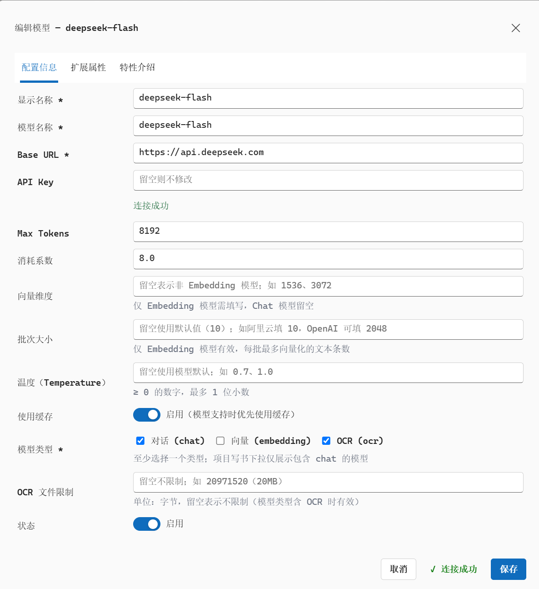

# [妙笔书生 MiaoBiShuSheng (AIBook)](https://aibook.longmaiyun.cn/)

 MiaoBiShuSheng (AIBook) is an AI-powered book & long-form writing platform for **general books**, **academic monographs**, and **serialized articles**. Upload local reference material, set the topic, audience and style, and it drives the whole pipeline — material analysis, reading report, topic planning, outline generation, chapter-by-chapter writing and final export.

## Highlights

- **Writes from local, reliable sources** — no web search, no scraping of unreliable open-internet content. It reads **10M+ characters of locally-uploaded reference material in one pass** (e.g. dozens of e-books), so every claim is grounded in material you trust.
- **Many books from one project** — from a single writing topic it drafts several book proposals and, once approved, generates **multiple books in a single run**, with total output reaching **over 1 million characters**.
- **Monograph-grade quality** — supports reference citations, SVG charts, LaTeX formulas, Mermaid mind maps, image insertion and tables, at or near publishable quality.
- **Short & long form** — equally capable of serialized media articles (推文) and full-length books, keeping theme, chapter flow and voice consistent throughout.
- **Unattended server-side work** — the entire writing job runs on the server; closing the browser or shutting down the PC never interrupts it.
- **Preview & export** — read and edit the finished book online, then export typeset **HTML / DOCX / PDF**.

## Screenshot

## Integrate with DeepSeek API

MiaoBiShuSheng uses the official [DeepSeek API](https://platform.deepseek.com/) (`https://api.deepseek.com`) as its underlying writing engine, configured with the **deepseek-flash** model. Every stage of the pipeline — reading report, topic & outline planning, chapter-by-chapter writing and final book assembly — is driven by DeepSeek, with Token consumption tracked transparently in the in-app project monitor.

Official site: https://aibook.longmaiyun.cn/
