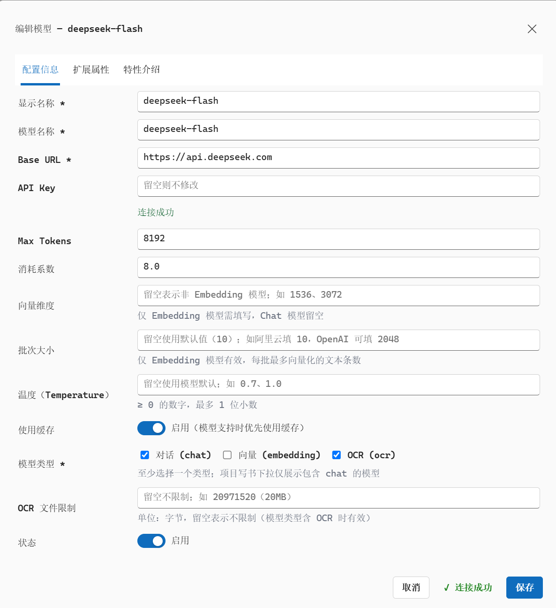

# [妙笔书生 MiaoBiShuSheng（AIBook）](https://aibook.longmaiyun.cn/)

 妙笔书生是一般图书、专著与系列推文的 AI 创作工具。上传参考资料，设定写作主题、受众与风格偏好，即可自动完成从资料分析、阅读报告、选题策划、目录生成、章节写作到最终导出的全部过程。

## 亮点

- **基于本地可靠资料写作** —— 不搜索、不使用互联网上良莠不齐的开放资料，**一次阅读千万字以上本地可靠参考资料**（例如数十本电子书），所有内容都有据可依。
- **多本图书一次生成** —— 围绕同一写作主题，智能生成多套策划方案，经确认后**一次性生成多本图书**，**输出字数可达百万字以上**。
- **专著级写作质量** —— 支持参考资料标引、SVG 图表、LaTeX 公式、Mermaid 思维导图、图像插入与表格，质量达到或接近出版水平。
- **短文与长篇均胜任** —— 既支持高质量系列推文，也胜任长篇“大部头”，主题鲜明、章节连贯、脉络清晰、表述统一。
- **后台工作无需值守** —— 全部工作在服务器上完成，关闭浏览器或电脑也不中断写书进程。
- **在线预览与成果导出** —— 成书后可在线上预览、编辑，并导出排版工整的 HTML / DOCX / PDF。

## 截图

## 与 DeepSeek API 集成

妙笔书生以官方 [DeepSeek API](https://platform.deepseek.com/)（`https://api.deepseek.com`）作为底层写作引擎，配置 **deepseek-flash** 模型，从阅读报告、选题策划、目录生成到逐章写作与成书，全程由 DeepSeek 驱动，并在项目监控中透明记录与统计 Token 消耗。

官网：https://aibook.longmaiyun.cn/
