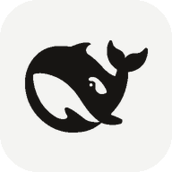

# [DShAndroid](https://github.com/kekejiang114514/deepseek-harness-android)

DeepSeek Harness for Android —— 把 DeepSeek 直接跑在手机上的安卓 Agent 客户端。不需要 Termux、不需要 root、不需要电脑：Agent 循环、工具运行时和界面都打进一个 APK 里。

## 功能

- **工具调用** —— 用 DeepSeek 原生的 `tools` / `tool_calls` 协议驱动命令行、文件读写、浏览器和屏幕自动化。
- **无障碍操作屏幕** —— 读取控件树后点按、输入、滑动，模型因此能操作设备上的其它应用。
- **上下文自动压缩** —— 历史超过约 24k tokens 时压缩较早的轮次并保留当前任务，长会话不会撞上窗口上限。
- **六档思考强度** —— 真正以 `reasoning_effort` 发出（`low` / `high` / `max`，按 Thinking Mode 文档）；`off` 档发送 `thinking: {"type": "disabled"}`。
- **模型列表实时读取** —— 选择器请求 `/models`，所以 `deepseek-flash` 和 `deepseek-v4-pro` 无需升级客户端就会出现。
- **可安装插件**、提示词预设、内置终端、按步骤的虚拟机面板，以及 token 用量面板。

## 接入 DeepSeek API

1. 在 [DeepSeek 开放平台](https://platform.deepseek.com/api_keys) 申请 API Key。
2. 从 [Releases 页面](https://github.com/kekejiang114514/deepseek-harness-android/releases/latest) 下载 APK 并安装打开。
3. 打开 **设置 → 模型**，填入 API Key。Base URL 默认 `https://api.deepseek.com`，只有自建网关才需要改。
4. 点输入框上方的模型胶囊，列表来自 `/models`。重推理选 `deepseek-v4-pro`，要快要省选 `deepseek-flash`。
5. 在模型名旁设置强度档位 —— 这才是真正发给接口的思考深度。

## 说明

- 屏幕自动化需要在系统设置里手动开启无障碍服务。部分安卓系统在强制停止应用时会连带删掉该包的无障碍记录；客户端会在启动时检测到，并提供一键跳回设置的入口。
- 最低 Android 10（API 29），arm64。
