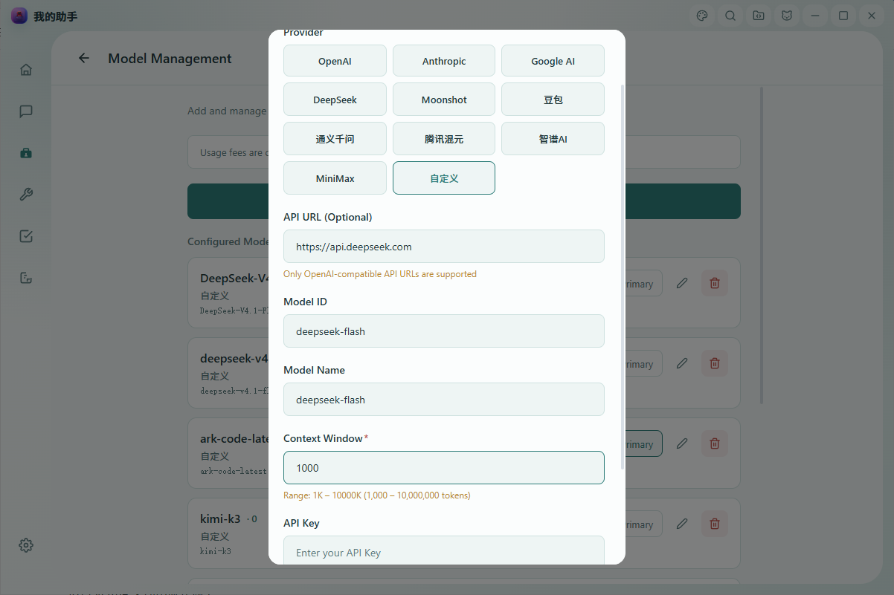
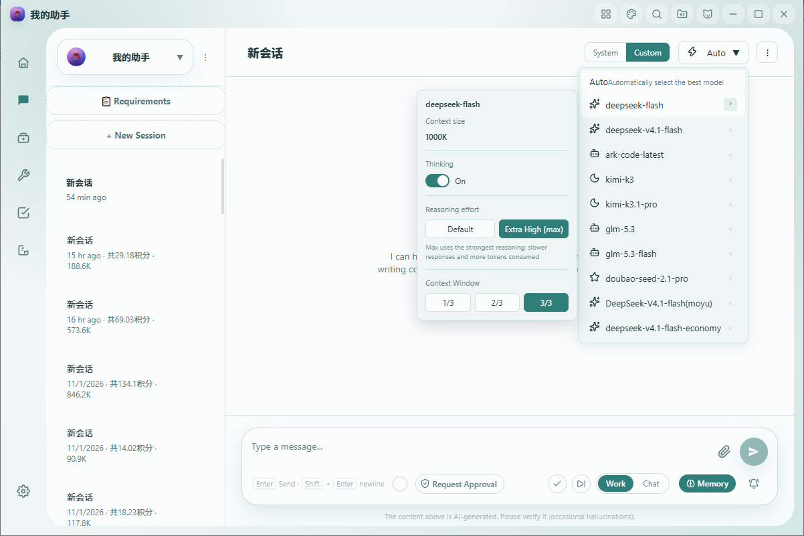

# [My Assis](https://www.my-assis.com)

**My Assis (我的助手 / myassis)** is a local AI assistant that lets you bring your own API key and connect to many large model providers. It ships on Windows desktop and iOS / Android mobile, with an agent team, tool calling, long context, and persistent memory. It can hold everyday conversations and also operate your computer, manage files, and run scheduled tasks.

This guide explains how to connect **DeepSeek V4** (`deepseek-v4-pro` / `deepseek-flash`) in My Assis, enable the **1M (1,000,000-token) context window**, and turn the reasoning effort up to its highest level.

> 📌 **Model name note**: the canonical Model ID for the lightweight, high-speed model is `deepseek-flash` (model version DeepSeek-V4.1-Flash-1017, natively multimodal). The legacy name `deepseek-v4-flash` is **still accepted** — requests sent with it are served by `deepseek-flash` and billed at the Flash price — but please use the canonical `deepseek-flash`.

---

## Table of Contents

- [1. Prerequisite: Create a DeepSeek API Key](#1-prerequisite-create-a-deepseek-api-key)
- [2. Add a DeepSeek V4 custom model](#2-add-a-deepseek-v4-custom-model)
- [3. Enable the 1M (1,000,000) context window](#3-enable-the-1m-1000000-context-window)
- [4. Set Reasoning effort to “Extra High”](#4-set-reasoning-effort-to-extra-high)
- [5. Send your first message to verify](#5-send-your-first-message-to-verify)
- [6. Mobile (iOS / Android)](#6-mobile-ios--android)
- [7. FAQ & notes](#7-faq--notes)
- [8. Download My Assis](#8-download-my-assis)

---

## 1. Prerequisite: Create a DeepSeek API Key

Before connecting, create an API key on the DeepSeek Open Platform:

1. Open the DeepSeek Open Platform: <https://platform.deepseek.com>.
2. Sign in, go to the API key management page, create a key, and copy it.
3. Keep the key somewhere safe — you will paste it into My Assis shortly.

> In the **Provider** field choose **Custom** (you may also pick **DeepSeek**, which pre-fills the address), then set **API URL** to `https://api.deepseek.com` — the official OpenAI-format root (the compatible `/v1` suffix also works).

---

## 2. Add a DeepSeek V4 custom model

On the desktop app, go to **Settings → Model management → Add custom model**.



Fill in the form as follows:

| Field | Value |
| --- | --- |
| Provider | Choose **Custom** (or **DeepSeek**, which pre-fills the address) |
| API URL | `https://api.deepseek.com` (the `/v1` suffix also works) |
| API Key | Paste the key you created on the DeepSeek Open Platform (**left blank in the screenshot for security**) |
| Model ID (modelId) | `deepseek-v4-pro` or `deepseek-flash` (the Model name can be anything; matching the Model ID is fine) |
| Total context | `1000` (unit: K) |

Then click **Save**.

> ⚠️ **The Model ID must be exact.** You may name the display label anything you like, but the underlying **Model ID (modelId) is passed through to the DeepSeek API verbatim**, so it must be one of these two exact lowercase strings:
>
> - `deepseek-v4-pro` — the flagship model with the strongest capability;
> - `deepseek-flash` — the lightweight, high-speed model (DeepSeek-V4.1-Flash-1017, natively multimodal) with faster responses and lower cost.
>
> Do not add spaces, capital letters, or any suffix to the Model ID, or the call will fail.

---

## 3. Enable the 1M (1,000,000) context window

DeepSeek V4’s **1M (1,000,000-token) context works out of the box and requires no special API parameters.** Both `deepseek-v4-pro` and `deepseek-flash` have a 1M context window (max output 384K).

When adding the model, simply set the **Total context** field to `1000` (unit: K), i.e. 1000 × 1000 = **1,000,000 tokens**. With this value, the client will not compress the conversation history early, and you can use the full 1M context window.

- The allowed range for the Total context field is **1K–10000K**;
- to use the full 1M, enter `1000`;
- **no extra parameter is required for 1M — just set Total context to 1000K.**

---

## 4. Set Reasoning effort to “Extra High”

DeepSeek V4 already runs with deep thinking enabled by default, and the official default reasoning effort is `high`. For the strongest performance on hard reasoning tasks, you can raise the reasoning effort to its highest level.

**Steps (desktop):**

1. Return to the **chat page**;
2. tap the **Model preferences entry next to the current model name at the top** (the gear / slider icon) to open the model preferences panel;
3. find **Reasoning effort** and select **Extra High**.



In the panel you will also see the following (independent) options:

- **Total context**;
- the **Thinking (`enable_thinking`) toggle**;
- **Reasoning effort**: a two-state segmented control with `Default` and `Extra High`;
- **Context window tiers**: `1/3`, `2/3`, `3/3`.

After selecting **Extra High** there is no save button — the setting **takes effect immediately and is persisted automatically** (saved independently per conversation × per model, and retained after a refresh or app restart).

**What happens under the hood:**

In the OpenAI format the reasoning effort parameter is `reasoning_effort`, with legal values `low` / `high` / `max` (`max` being the strongest tier). My Assis exposes only two states: **Default** sends no `reasoning_effort` (keeping the official `high` default), and **Extra High** sends `reasoning_effort: "max"`.

- When reasoning effort is set to **Extra High**, the app sends the following field in that conversation’s HTTP request body to DeepSeek:

  ```json
  {
    "reasoning_effort": "max"
  }
  ```

  Note that the value is the string `"max"`, not a number.
- When you switch back to **Default**, the app **does not send** the `reasoning_effort` field, restoring the model’s default behavior.
- The Reasoning effort option **only appears when the current model is DeepSeek**; for models from other providers this field is not sent by default, so there is no cross-provider interference.

> 📌 **Thinking ≠ Reasoning effort.** The **Thinking (`enable_thinking`)** toggle and **Reasoning effort (`reasoning_effort`)** in the panel are **two independent settings — do not conflate them.** The “Extra High” level described here maps only to `reasoning_effort: "max"`. It does not require or depend on enabling `enable_thinking`, and DeepSeek V4 does not require `enable_thinking` to be sent. In the official docs the thinking toggle is a separate parameter, `thinking.type` (`enabled` / `disabled`), independent of `reasoning_effort`.

---

## 5. Send your first message to verify

Once configured, just send a message in the current conversation, for example:

> Explain what a vector database is in three sentences.

- If the model streams back a reply normally, the Model ID, Base URL, and API key are all configured correctly.
- For an ordinary user, selecting **Extra High** for reasoning effort in the UI means maximum reasoning is already on; for technical confirmation, you can see `reasoning_effort: "max"` in the request body that the conversation sends to DeepSeek.

---

## 6. Mobile (iOS / Android)

The mobile flow mirrors the desktop app; only the entry point differs:

- In the **model selector sheet on the chat page**, when you select a **DeepSeek** model, the same **Reasoning effort `Default` / `Extra High` two-state control** appears;
- selecting Extra High is equivalent to the desktop’s `reasoning_effort: "max"`; switching back to Default omits the field;
- the Model ID must still be `deepseek-v4-pro` or `deepseek-flash`, and to use the full 1M context set Total context to `1000`K.

---

## 7. FAQ & notes

**Q1. Can I enter `DeepSeek-V4-Pro` or a custom name as the Model ID?**
No. The display label is customizable, but the Model ID (modelId) is passed through to the DeepSeek API verbatim and must be exactly `deepseek-v4-pro` or `deepseek-flash` (all lowercase).

**Q2. Do I need a special request parameter to turn on 1M context?**
No. 1M works out of the box. Just set Total context to `1000` (K) so the client won’t compress context early. The field accepts values from 1K to 10000K.

**Q3. What is the impact of selecting “Extra High”?**
`reasoning_effort: "max"` is the strongest reasoning tier. Responses are generally **slower and consume more tokens**, which suits difficult reasoning, math, and coding tasks; for everyday chat, Default is sufficient.

**Q4. How do I revert to default and stop sending `reasoning_effort`?**
Set reasoning effort back to Default in the model preferences panel; the app will then no longer send that field in the request body.

**Q5. Are the “Thinking (enable_thinking)” toggle and “Reasoning effort” the same thing?**
No. They are independent: reasoning effort maps to `reasoning_effort` (highest tier `"max"`), while the thinking toggle maps to `enable_thinking`. Selecting Extra High does not require turning thinking on.

**Q6. I also use models from other providers — will this affect them?**
No. The reasoning effort option only appears for DeepSeek models; for other providers the `reasoning_effort` field is not sent by default. Settings are stored independently per conversation × per model.

**Q7. Are the settings lost after a refresh or app restart?**
No. Model preferences such as reasoning effort are persisted and remain in effect after a restart; no manual save is needed.

---

## 8. Download My Assis

- Website: <https://www.my-assis.com>
- The desktop app (primarily Windows; macOS via the website) is available on the website and in app stores; the mobile app supports iOS and Android.
