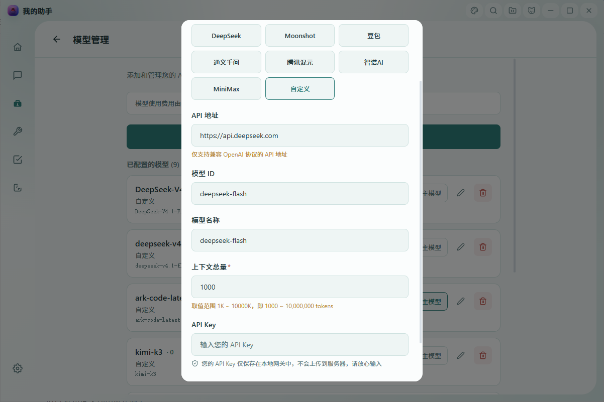
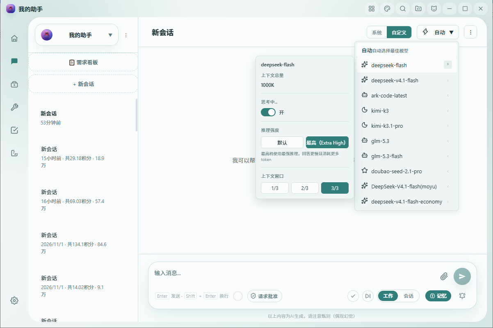

# [我的助手 My Assis](https://www.my-assis.com)

**我的助手（My Assis / myassis）** 是一款可自带 API Key、接入多家大模型的本地 AI 助手，提供 Windows 桌面端与 iOS / Android 移动端。它内置 Agent 团队、工具调用、超长上下文与长期记忆，既能日常对话，也能直接操作电脑、管理文件与定时任务。

本指南介绍如何在「我的助手」中接入 **DeepSeek V4**（`deepseek-v4-pro` / `deepseek-flash`），开启 **1M（1,000,000 tokens）超长上下文**，并把推理强度调到最高档。

> 📌 **模型名说明**：轻量高速模型的规范模型名是 `deepseek-flash`（模型版本 DeepSeek-V4.1-Flash-1017，原生支持多模态视觉）。旧名 `deepseek-v4-flash` 官方**仍然兼容**——用它发请求会由 `deepseek-flash` 提供服务、按 Flash 价格计费——但建议一律使用规范名 `deepseek-flash`。

---

## 目录

- [一、前置准备：创建 DeepSeek API Key](#一前置准备创建-deepseek-api-key)
- [二、添加 DeepSeek V4 自定义模型](#二添加-deepseek-v4-自定义模型)
- [三、开启 1M（1,000,000）超长上下文](#三开启-1m1000000超长上下文)
- [四、把推理强度调到「最高（Extra High）」](#四把推理强度调到最高extra-high)
- [五、发送第一条消息验证](#五发送第一条消息验证)
- [六、移动端（iOS / Android）](#六移动端ios--android)
- [七、常见问题与注意事项](#七常见问题与注意事项)
- [八、下载我的助手](#八下载我的助手)

---

## 一、前置准备：创建 DeepSeek API Key

在接入前，请先到 DeepSeek 开放平台创建一个 API Key：

1. 打开 DeepSeek 开放平台：<https://platform.deepseek.com>
2. 登录后进入 API Key 管理页面，创建并复制你的 API Key。
3. 妥善保存该 Key，稍后需要粘贴到「我的助手」中。

> 在「提供商」中选择 **自定义**（也可以直接选 **DeepSeek**，选它会自动预填地址），然后在「API 地址」中填入 `https://api.deepseek.com`——这就是官方 OpenAI 格式根地址（兼容的 `/v1` 后缀亦可正常使用）。

---

## 二、添加 DeepSeek V4 自定义模型

在桌面端依次操作：**设置 → 模型管理 → 添加自定义模型**。



按下表填写：

| 字段 | 填写内容 |
| --- | --- |
| 提供商 | 选择 **自定义**（也可直接选 **DeepSeek**，选它会自动预填地址） |
| API 地址 | 填入 `https://api.deepseek.com`（带 `/v1` 后缀亦可正常使用） |
| API Key | 粘贴你在 DeepSeek 开放平台创建的 Key（**图示中为安全起见留空 / 未显示**） |
| 模型 ID（modelId） | `deepseek-v4-pro` 或 `deepseek-flash`（「模型名称」可任意填，建议与模型 ID 相同） |
| 上下文总量 | `1000`（单位 K） |

填写完成后点击**保存**。

> ⚠️ **模型 ID 必须精确填写**：界面上的「显示名称」你可以自由命名，但底层的**模型 ID（modelId）会被原样透传到 DeepSeek API**，因此必须是以下两个精确的小写字符串之一：
>
> - `deepseek-v4-pro` —— 旗舰模型，能力最强；
> - `deepseek-flash` —— 轻量高速模型（DeepSeek-V4.1-Flash-1017，原生支持多模态视觉），响应更快、成本更低。
>
> 不要在模型 ID 中加入空格、大写字母或其它后缀，否则将无法正确调用。

---

## 三、开启 1M（1,000,000）超长上下文

DeepSeek V4 的 **1M（1,000,000 tokens）上下文是开箱即用（out of the box）的，不需要任何特殊 API 参数**。`deepseek-v4-pro` 与 `deepseek-flash` 两个模型的上下文长度均为 1M（最大输出 384K）。

你只需要在添加模型时，把**「上下文总量」字段填为 `1000`（单位 K）**，即 1000 × 1000 = **1,000,000 tokens**。这样客户端就不会提前对历史对话做上下文压缩，可以用满整个 1M 上下文窗口。

- 「上下文总量」字段允许的填写范围为 **1K ～ 10000K**；
- 要用满 1M，就填 `1000`；
- **无需为 1M 设置任何额外参数，只要把上下文总量填成 1000K 即可。**

---

## 四、把推理强度调到「最高（Extra High）」

DeepSeek V4 默认就已经开启了深度思考，官方默认推理强度为 `high`。如果你希望在复杂推理任务上获得最强表现，可以把「推理强度」调到最高档。

**操作路径（桌面端）：**

1. 回到**聊天页**；
2. 点击顶部**当前模型名旁边的「模型偏好」入口**（齿轮 / 滑块图标），打开模型偏好浮层；
3. 在浮层中找到**「推理强度 / Reasoning effort」**，选择 **「最高（Extra High）」**。



浮层中你会同时看到这些选项（彼此独立）：

- **上下文总量**；
- **思考（`enable_thinking`）开关**；
- **推理强度**：`默认` 与 `最高（Extra High）` 两态分段按钮；
- **上下文窗口档位**：`1/3`、`2/3`、`3/3`。

选择**「最高（Extra High）」**后无需点击保存按钮，设置会**即时生效并自动持久化**（按「每个会话 × 每个模型」独立保存，刷新或重启应用后依然保留）。

**底层行为说明：**

官方 OpenAI 格式的推理强度参数是 `reasoning_effort`，合法值为 `low` / `high` / `max`（`max` 对应最强档）；本产品只暴露两档：「默认」不下发该字段、沿用官方默认的 `high`，「最高（Extra High）」下发 `reasoning_effort: "max"`。

- 当推理强度选为**「最高（Extra High）」**时，产品会在该会话发往 DeepSeek 的 HTTP 请求体中下发：

  ```json
  {
    "reasoning_effort": "max"
  }
  ```

  请注意该值是字符串 `"max"`，不是数字。
- 当切回**「默认」**时，产品**不会下发** `reasoning_effort` 字段，即恢复模型默认表现。
- 「推理强度」选项**仅当当前模型为 DeepSeek 时才会出现**；其它厂商的模型默认不会下发此字段，互不影响。

> 📌 **「思考」开关 ≠ 「推理强度」**：浮层里的**思考（`enable_thinking`）**与**推理强度（`reasoning_effort`）是两个相互独立的设置，请不要混为一谈**。本指南所说的「最高档」只对应 `reasoning_effort: "max"`，并不要求、也不依赖开启 `enable_thinking`，更不是说 DeepSeek V4 必须传 `enable_thinking`。官方文档中思考开关对应的是独立参数 `thinking.type`（`enabled` / `disabled`），与 `reasoning_effort` 互不影响。

---

## 五、发送第一条消息验证

设置完成后，直接在当前会话发送一条消息即可，例如：

> 请用三句话解释什么是向量数据库。

- 如果模型正常流式返回结果，说明模型 ID、Base URL 与 API Key 均已配置正确。
- 普通用户在界面上把推理强度选到**「最高（Extra High）」**，即代表已开启最强推理；如需从技术层面确认，可在该会话发往 DeepSeek 的请求体中看到 `reasoning_effort: "max"`。

---

## 六、移动端（iOS / Android）

移动端操作与桌面端一致，区别仅在于入口：

- 在**聊天页的模型选择器弹层**内，当你选中一个 **DeepSeek** 模型时，会同样出现**「推理强度」的 `默认` / `最高` 两态**选项；
- 选择「最高」即等同于桌面端的 `reasoning_effort: "max"`，切回「默认」则不下发该字段；
- 模型 ID 同样必须填 `deepseek-v4-pro` 或 `deepseek-flash`；要用满 1M 上下文，把上下文总量填为 `1000`K。

---

## 七、常见问题与注意事项

**Q1：模型 ID 可以填 `DeepSeek-V4-Pro` 或自己起的名字吗？**
不可以。界面显示名可以自定义，但模型 ID（modelId）会被原样透传给 DeepSeek API，必须精确填 `deepseek-v4-pro` 或 `deepseek-flash`（全小写）。

**Q2：开启 1M 上下文需要在请求里加特殊参数吗？**
不需要。1M 上下文开箱即用，只要把「上下文总量」填为 `1000`（K）即可，客户端就不会提前压缩上下文。该字段允许范围为 1K～10000K。

**Q3：选了「最高（Extra High）」会有什么影响？**
`reasoning_effort: "max"` 是最强推理档，回答通常会**更慢、消耗更多 token**，适合复杂推理、数学、代码等困难任务；日常闲聊用「默认」即可。

**Q4：如何恢复默认、不再发送 `reasoning_effort`？**
在模型偏好浮层把推理强度切回「默认」即可，产品此后将不再在请求体中下发该字段。

**Q5：「思考（enable_thinking）」和「推理强度」是一回事吗？**
不是。二者相互独立：推理强度对应 `reasoning_effort`（最高档为 `"max"`），思考开关对应 `enable_thinking`。调到最高档不要求开启思考开关。

**Q6：我同时接了其它厂商的模型，会受影响吗？**
不会。推理强度选项仅对 DeepSeek 模型出现；其它厂商模型默认不下发 `reasoning_effort` 字段，彼此互不影响。设置按「每个会话 × 每个模型」独立保存。

**Q7：刷新或重启应用后设置会丢失吗？**
不会。推理强度等模型偏好会被持久化保存，重启应用后仍然生效，且无需手动点保存。

---

## 八、下载我的助手

- 官网：<https://www.my-assis.com>
- 桌面端（Windows 为主，macOS 可咨询官网）可在官网或应用商店下载；移动端支持 iOS 与 Android。
