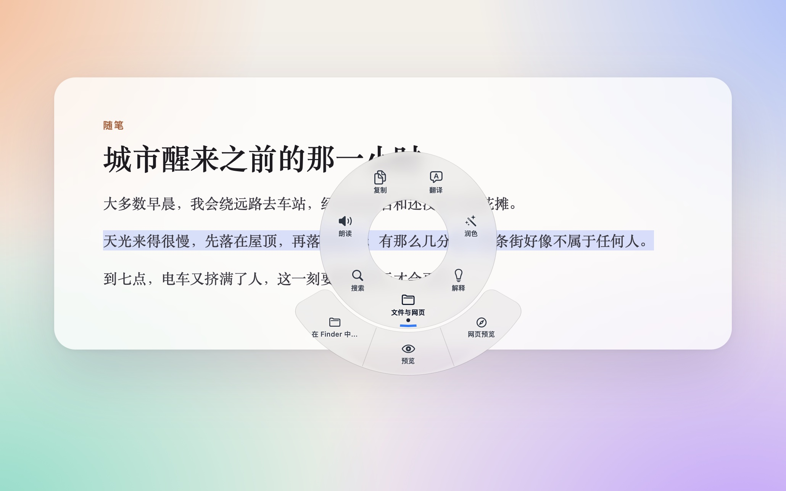

<div align="center">
  
  <h1>QDuo</h1>
  <p>
    <a href="https://github.com/XueshiQiao/qduo">GitHub</a> ·
    <a href="./README.md">English</a> ·
    <b>简体中文</b>
  </p>
</div>

**QDuo** 是一款开源（GPL v3.0）的原生 macOS（macOS 13+）划词动作与 AI 弹窗应用。在 Mac 的任意应用里选中文字，光标旁就会出现你配置的动作——翻译、对比后润色、解释、总结、朗读、本地文本处理，或直接向大模型提问——结果还能直接写回原处。

<div align="center">
  
</div>

## 主要特性

- **多种光标弹窗样式**：提供**水玻璃**圆环、**立体玻璃**微倾圆环与**胶囊**横条三种样式，支持把动作收进二级分组。
- **内置 AI 动作与独立选模型**：默认自带「翻译」「润色」「解释」，模板库还提供总结、语法纠错、改语气、句子解析、解释代码及自定义提示词；每个动作均可单独指定模型。
- **先对比，再替换**：润色或改写文本时，先在弹窗里标出删减与新增的字词，确认后再一键写回原输入框。
- **截屏取字与本地工具**：支持 `⌘⇧S` 框选画面本机 OCR 取字、22 种离线文本处理，以及运行快捷指令与 Shell 脚本。
- **历史记录与隐私安全**：本地记录历史操作；API Key 仅保存在 macOS 钥匙串中，不写入配置文件。

## 安装

使用 Homebrew 安装：

```bash
brew install --cask XueshiQiao/tap/qduo
```

也可以直接从 [GitHub Releases](https://github.com/XueshiQiao/qduo/releases) 下载已公证的 `QDuo.dmg`。

## 在 QDuo 中接入 DeepSeek

1. 打开 **QDuo**——应用默认内置 **DeepSeek** 作为首选服务商，已预填接口地址 `https://api.deepseek.com`。
2. 在首次引导页或「**设置 → AI 模型**」中确认选中 **DeepSeek**，填入从 [DeepSeek 开放平台](https://platform.deepseek.com/) 获取的 API Key，点击**测试**验证连接。
3. 在任意应用中选中文字，点击**翻译**、**润色**、**解释**或你自定义的 AI 提示词动作，即可直接在光标旁调用 DeepSeek 处理并写回文本。
